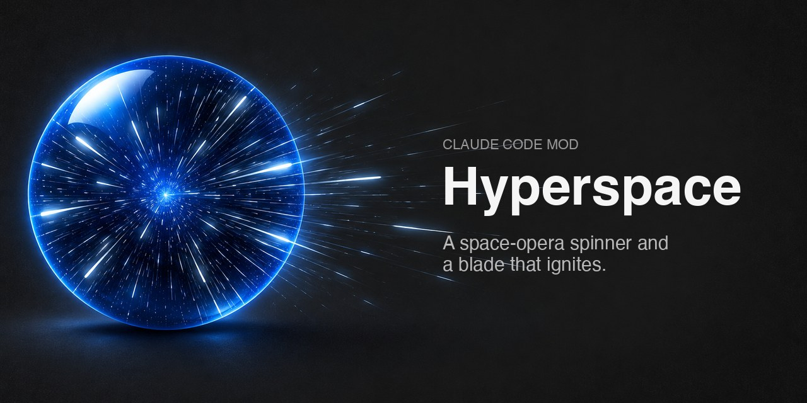
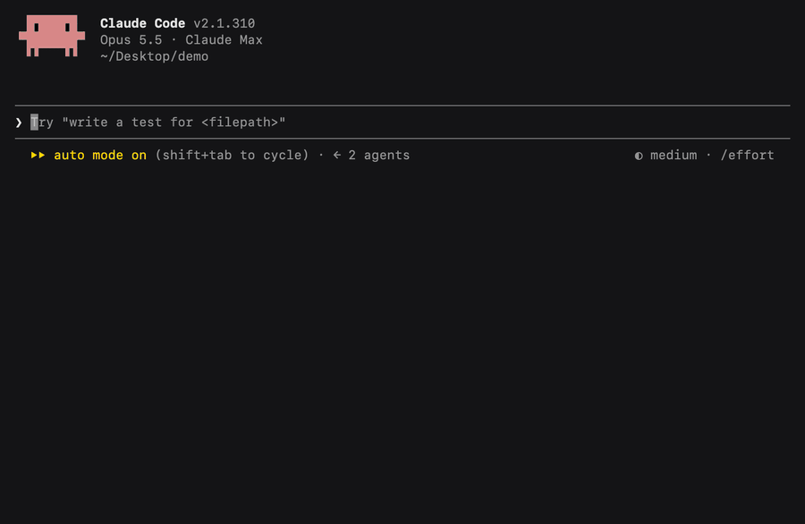
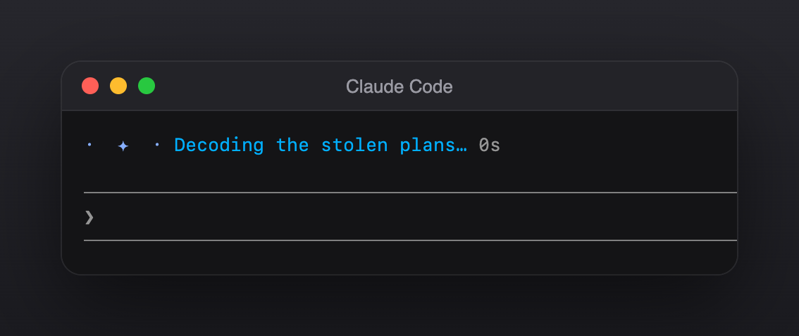
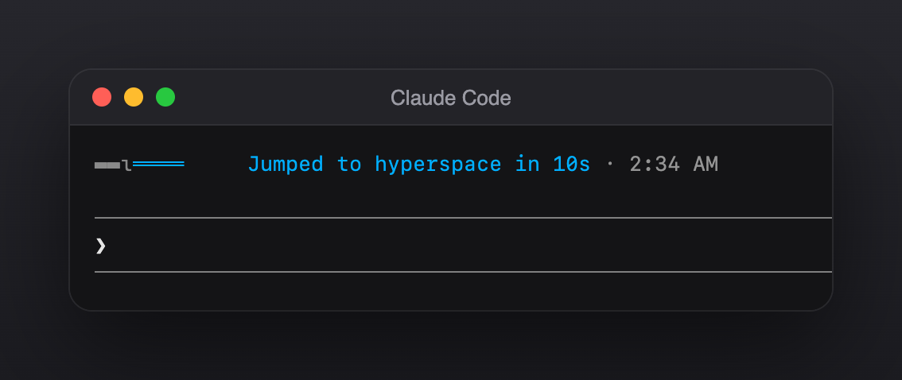

<p align="center"></p>

<h1 align="center">Hyperspace for Claude Code: a space-opera spinner and a blade that ignites</h1>

<p align="center">Hyperspace is a Claude Code mod that swaps the spinner's words for space-opera ones ("Making the jump to lightspeed"), flies stars past them, and lights a blade on the line that says how long Claude took.</p>

<p align="center">
  <a href="LICENSE"></a>
  
  
</p>

<p align="center"><a href="#install">Install</a> · <a href="#what-it-looks-like">What it looks like</a> · <a href="#faq">FAQ</a> · <a href="#watch-it">Watch the tour</a></p>

<p align="center"></p>

## Install

In Claude Code:

```
/plugin install hyperspace --marketplace hg913488/claude-code-hyperspace
```

That's it. The next time Claude works, you're in hyperspace.

In the desktop app, click **+** next to the prompt box → **Plugins** → **Add marketplace** → `hg913488/claude-code-hyperspace` → **Add plugin**.

## What it looks like

<p align="center"><br><sub><b>While Claude works</b> · stars and space-opera words</sub></p>

<p align="center"><br><sub><b>When it's done</b> · the blade on the turn-time line</sub></p>

## What changes

- **The spinner** picks words for what Claude is doing:
  - Thinking: "Consulting the ancient archives", "Reading the stars".
  - Running tools: "Making the jump to lightspeed", "Navigating the asteroid field", "Bypassing the hyperdrive motivator".
  - About to act: "Plotting a course", "Punch it".

  Stars fly out from the middle in hyperspace blue, with the seconds counting beside them.
- **The closing line** says how long the turn took ("Made the smuggler's run in 1m 4s", "Outran the patrol in 12s") and the time it finished. A blade ignites from its hilt beside it, once, and stays lit.

One phrase is picked per turn, so the words don't flicker while Claude works.

## FAQ

**How do I change the Claude Code spinner words?**
Install this mod. It replaces the spinner's words with space-opera ones on every turn. Uninstall it to get the usual words back.

**Does it change what Claude does?**
No. It only changes the words and the animation on your screen.

**Does it work with Retro Chat?**
Yes. While a [Retro Chat](https://github.com/hg913488/claude-code-retro-skins) skin is on, that skin draws the spinner and Hyperspace steps aside. `/skin off` brings hyperspace back.

**Does it work in the desktop app?**
Yes. The stars and the blade are drawn in the terminal and in the desktop app.

**How do I uninstall it?**
`/plugin uninstall hyperspace`, or `claude plugin uninstall hyperspace` from a shell.

## Watch it

https://github.com/user-attachments/assets/b72a51fb-f554-46c9-ac07-de7a9e1a8e67

A 20-second clip of a turn in hyperspace.

---

MIT licensed. Made by [HG](https://github.com/hg913488). An original homage to space opera; not affiliated with any film or studio.
